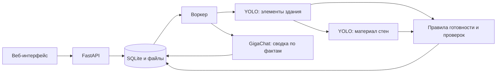

# Мониторинг строительства ИЖС

Прототип сервиса для контроля строительства индивидуальных жилых домов по фотографиям с дрона. Помогает сотруднику банка оценить видимую готовность дома, определить материал стен, сравнить результат с проектом и графиком и заметить признаки отставания до возникновения задолженности.

**YOLO распознаёт элементы здания и материал стен. Бэкенд объединяет результаты и выполняет расчёты. GigaChat объясняет подготовленные факты. Итоговое решение принимает сотрудник.**

## Что работает

- Создание объектов с кадастровым номером, параметрами проекта, сроками и контрольными точками.
- Загрузка облётов: оригиналы фотографий, EXIF, GPS, превью и история обработки.
- Две модели: детектор элементов строительства и отдельный классификатор материала на вырезках стен.
- Расчёт стадии, внутреннего процента готовности и банковской шкалы `0 / 50 / 100`.
- Объединение наблюдений с нескольких фасадов, сравнение материала с проектом и ручная проверка результатов.
- Выбор области дома на снимке и исключение детекций за её пределами.
- Предварительная стоимость постройки: полная сумма, условно выполненная часть и остаток на достройку.
- AI-сводка GigaChat: пояснение фактов, признаков отставания и предложения для сотрудника.
- Веб-интерфейс с карточками объектов, фотографиями, результатами моделей и историей.

## Как устроен сервис



API принимает запросы, воркер обрабатывает задания в фоне, а интерфейс показывает результат. Очередь хранится в SQLite и переживает перезапуск. GigaChat получает подготовленные обезличенные факты; фотографии распознаются локальными моделями.

## Быстрый запуск

Нужны **Python 3.11+** и **Node.js**. GPU необязателен. Все команды ниже выполняются в **PowerShell из корня проекта**.

### 1. Установить зависимости

```powershell
python -m venv .venv
.\.venv\Scripts\python.exe -m pip install -r requirements-inference.txt
if (-not (Test-Path -LiteralPath '.env')) { Copy-Item -LiteralPath '.env.example' -Destination '.env' }
```

`requirements-inference.txt` включает бэкенд и Ultralytics `>=8.4`, необходимый для весов YOLO26. Для работы API без локальных моделей достаточно `requirements-backend.txt`. Зависимости обучения из `req.txt` для запуска сервиса не требуются.

### 2. Подключить модели

Получите обученные веса у ML-команды и положите их в корень проекта в таком виде:

```text
weights/
├── readiness_yolo26m.pt       # детектор элементов здания
└── material_yolo26m-cls.pt    # классификатор материала стен
```

В `.env` укажите:

```dotenv
MOCK=0
DETECTOR_FACTORY=agents.readiness.yolo:create_detector
READINESS_WEIGHTS=weights/readiness_yolo26m.pt
MATERIAL_MODEL_FACTORY=agents.material.yolo:create_predictor
MATERIAL_WEIGHTS=weights/material_yolo26m-cls.pt
```

Веса передаются отдельно и не хранятся в Git. После замены весов перезапустите воркер; после изменения `.env` или правил в `configs/` — API и воркер. Старые результаты автоматически не пересчитываются: для проверки новой модели загрузите новый облёт.

### 3. Запустить три компонента

Оставьте каждый процесс работающим в отдельном терминале.

**Терминал 1 — API:**

```powershell
.\.venv\Scripts\python.exe -m uvicorn api.main:app --host 127.0.0.1 --port 8000
```

**Терминал 2 — обработка фотографий и AI-сводок:**

```powershell
.\.venv\Scripts\python.exe -m worker
```

**Терминал 3 — интерфейс и прокси к API:**

```powershell
$env:API_TARGET = "http://127.0.0.1:8000"
node front/server.mjs
```

Для запуска интерфейса установка npm-пакетов не требуется; они нужны для проверок разработки.

### 4. Открыть интерфейс

Перейдите на **[http://127.0.0.1:4173](http://127.0.0.1:4173)**. Откройте **«Подключение и профиль» → «Источник данных» → «Настоящий API /api/v1» → «Применить»**.

| Адрес | Назначение |
| --- | --- |
| [localhost:4173](http://127.0.0.1:4173) | Веб-интерфейс |
| [localhost:8000/docs](http://127.0.0.1:8000/docs) | Swagger: описание и проверка API |
| [localhost:8000/api/v1/health](http://127.0.0.1:8000/api/v1/health) | Состояние API и значение `mock` |
| [localhost:8000/api/v1/meta](http://127.0.0.1:8000/api/v1/meta) | Доступные функции, классы и пороги |

**Два разных деморежима:** режим «Демо» в интерфейсе показывает синтетические данные без бэкенда. Настройка `MOCK=1` на бэкенде позволяет проверять загрузку и очередь, но возвращает `is_demo: true` и `model_unavailable` вместо распознавания. Для настоящей обработки нужны режим API в интерфейсе, `MOCK=0` и подключённые веса.

## Проверка на фотографиях

1. Создайте объект, укажите проектный материал, сроки и при необходимости площадь дома.
2. Загрузите фотографии **одного дома за один облёт**. Для проверки можно использовать снимки из одной папки `dataset/`.
3. Проверьте ракурсы и принадлежность фотографий объекту. `target_confirmed` отмечайте только после проверки, что снят нужный дом.
4. Дождитесь перехода `queued → processing → done`. Откройте фотографии, материал, готовность и стоимость в карточке.
5. При включённом GigaChat дождитесь AI-сводки. При необходимости подтвердите или исправьте результаты вручную: исходный ответ модели сохранится.

Рекомендуемый комплект — четыре фасада и два снимка сверху: дом крупно (`top_low`) и участок целиком (`top_high`). API принимает от 1 до 20 снимков JPG/PNG размером до 30 МБ каждый. Неполный облёт может потребовать проверки или досъёмки.

Материал автоматически закрепляется только при выполнении правил уверенности, достаточном числе фасадов и подтверждённом объекте. `unclear`, `hidden` и состояния проверки — часть результата, а не сбой сервиса.

## GigaChat

Добавьте в локальный `.env`:

```dotenv
GIGACHAT_ENABLED=1
GIGACHAT_CREDENTIALS=ваш_Authorization_Key_без_Basic
GIGACHAT_SCOPE=GIGACHAT_API_PERS
GIGACHAT_MODEL=GigaChat-2
GIGACHAT_AUTO_ANALYZE=1
```

Выберите модель, доступную вашему ключу. При необходимости добавьте доверенный сертификат через `GIGACHAT_CA_BUNDLE`; подробности — в [инструкции подключения](material/GIGACHAT_SETUP.md).

Проверка авторизации и доступных моделей:

```powershell
.\.venv\Scripts\python.exe -m integrations.gigachat --check
```

После настройки перезапустите API и воркер. Ключ хранится только на бэкенде; `.env` не добавляется в Git. При выключенном или недоступном GigaChat обработка фотографий продолжает работать, а сводка использует резервный вывод по правилам.

## Что важно учитывать

- **Готовность относится к видимым элементам дома.** Снимки с дрона не подтверждают внутреннюю отделку, коммуникации и скрытые работы.
- **Отделка может скрывать материал стен.** Уверенность детектора стены и уверенность классификатора материала — разные величины.
- **Выбор дома не доказывает кадастровую принадлежность.** Сейчас область выбирается по переданному `target_bbox`, данным облёта и камеры либо положению дома в центре кадра. Автоматического получения кадастровых контуров нет; принадлежность объекта подтверждает сотрудник.
- **Стоимость ориентировочная.** Используются демонстрационные ставки: площадь × ставка по материалу. Выполненная часть оценивается по готовности. Это не рыночная оценка, не стоимость залога и не подтверждение фактических расходов.
- **AI-сводка — предложение сотруднику.** Сервис сравнивает факты с графиком, но полный банковский риск, дирижёр, автоматические уведомления, судебные действия и анализ освоения участка пока не реализованы. Поддерживаемые функции перечислены в `/api/v1/meta`.
- **Текущая сборка предназначена для локальной демонстрации.** Заголовок `X-User` фиксирует автора ручных действий и не заменяет авторизацию пользователей.

## Структура проекта

| Каталог | За что отвечает |
| --- | --- |
| `api/` | HTTP API, SQLite, файлы, история и представление результатов |
| `worker/` | Фоновая обработка облётов и заданий анализа |
| `agents/readiness/` | Детектор, качество снимков и правила готовности |
| `agents/material/` | Классификация вырезок стен и объединение результатов |
| `agents/targeting.py`, `agents/geo.py` | Выбор области дома и работа с геометрией облёта |
| `agents/valuation/` | Предварительный расчёт стоимости строительства |
| `agents/analysis/`, `integrations/gigachat/` | Факты, промпты, вызов GigaChat и проверка ответа |
| `schemas/` | Форматы входных данных и результатов |
| `configs/` | Классы, пороги, правила готовности и тарифы |
| `front/` | Веб-интерфейс и Node.js-прокси |
| `tests/`, `front/tests/` | Проверки бэкенда, интерфейса и интеграции |
| `material/` | Документация и материалы кейса |

По умолчанию SQLite, загруженные копии снимков и результаты находятся в `.local/material-backend/`. Путь меняется через `STORAGE_DIR`; API и воркер должны использовать одно хранилище. Исходный `dataset/` сервис не изменяет. Переменные окружения имеют приоритет над `.env`.

## Если что-то не работает

| Симптом | Что проверить |
| --- | --- |
| Видны демонстрационные объекты | Выберите источник «Настоящий API /api/v1» в интерфейсе |
| Интерфейс сообщает о недоступном API | Запущен ли API; задан ли `API_TARGET` в терминале фронта |
| Облёт остаётся `queued` | Запущен ли воркер из корня проекта с тем же `STORAGE_DIR` |
| `model_unavailable` | `MOCK=0`, наличие весов, фабрики моделей и ошибки в терминале воркера |
| Результат требует проверки | Прочитайте причины: снимков, уверенности или подтверждений может быть недостаточно |
| Нет AI-сводки GigaChat | Настройки интеграции, команда `--check` и работающий воркер |

## Проверки разработки

```powershell
.\.venv\Scripts\python.exe -m pip install -r requirements-dev.txt
.\.venv\Scripts\python.exe -m pytest -q
.\.venv\Scripts\python.exe -m ruff check api agents integrations schemas worker tests
npm.cmd --prefix front ci
npm.cmd --prefix front test
npm.cmd --prefix front run test:integration
```

Сквозная проверка требует установленного Chrome. Она запускает API, воркер и интерфейс на свободных портах с отдельным хранилищем и тестовыми моделями, затем останавливает свои процессы. Качество настоящих весов проверяется отдельно на реальных фотографиях.

## Документация

- [Запуск общей сборки](material/INTEGRATION.md)
- [Контракт действующего API материалов](material/MATERIAL_API.md)
- [Подключение YOLO и правила обработки стен](material/YOLO_INTEGRATION.md)
- [Настройка и ограничения GigaChat](material/GIGACHAT_SETUP.md)
- [Расчёт стоимости постройки](material/VALUATION.md)
- [Простое объяснение для защиты](material/HOW_IT_WORKS.md)
- [Общий проектный контракт и планы команды](material/API.md) — отдельные разделы описывают будущие функции; реализованные маршруты доступны в Swagger.
